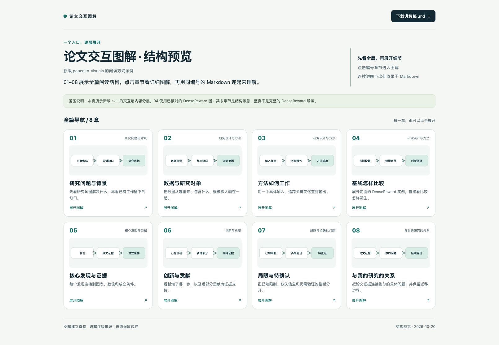
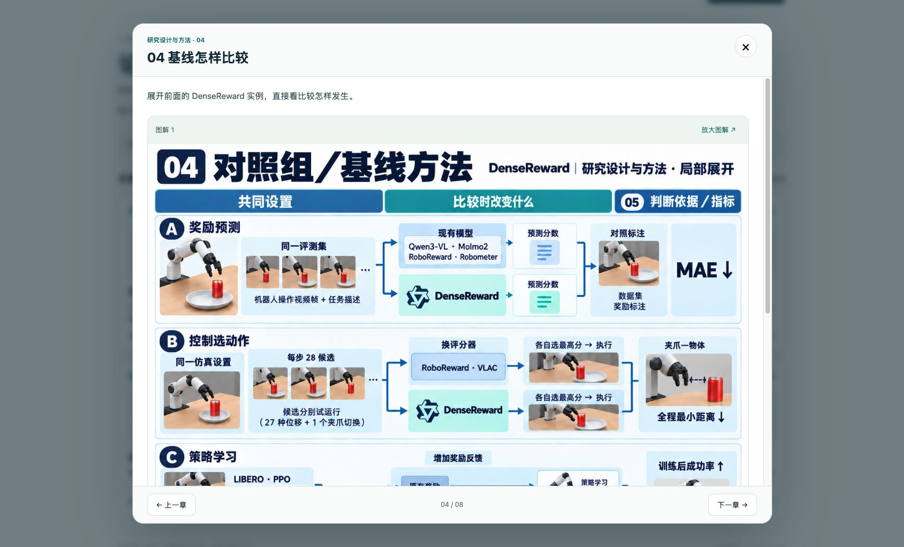

# Paper to Visuals · 论文交互图解

把一篇论文制作成**可离线打开的 HTML 导览**和**配套 Markdown 讲解**。

首页用 `01–0n` 展示全篇章节；点击某一章，展开更详细的流程、对照、公式或证据图。Markdown 使用相同编号，把图中的省略部分连贯讲清楚。

An Agent Skill for evidence-grounded paper explanations, with an offline interactive HTML reader and matching Chinese Markdown notes.



## 输出是什么

| 成品 | 阅读方式 |
|---|---|
| `论文导览.html` | 看全篇主线，点击章节展开详细图解，放大图形、切换章节、查看来源 |
| `论文讲解.md` | 独立阅读完整讲解，理解方法、公式、实验条件和证据边界 |

- **先讲关系，再放名称。** 方法图追踪一个输入如何变成输出；基线图展示共同设置、改变的环节和判断依据。
- **概览与细节分层。** 首页用简图定位主题，弹窗增加理解所需的信息。
- **结论能追溯。** 保留章节、图表或页码，以及比较对象、单位和成立条件。
- **未知保持可见。** 区分作者主张、证据支持、解读者判断和待确认事项。

默认覆盖研究背景、研究设计与方法、发现与证据、创新、局限、研究联系六部分。复杂内容可以拆章，章节数量随论文决定。没有用户研究背景时，研究联系保留待补充状态。

## 安装

### 使用 Skills CLI

需要 Node.js 22.20 或更新版本，以及可用的 Git：

```bash
npx skills add syaok1/paper-to-visuals --skill paper-to-visuals
```

按提示选择安装到哪个 agent。安装到 Codex 的当前项目：

```bash
npx skills add syaok1/paper-to-visuals --skill paper-to-visuals -a codex
```

需要跨项目使用时加 `-g`。仅查看仓库中的 skill：

```bash
npx skills add syaok1/paper-to-visuals --list
```

这些参数遵循 [Skills CLI 官方说明](https://github.com/vercel-labs/skills/blob/main/docs/commands.md)。

### 在 Codex 中安装

向 Codex 发送：

```text
请使用 $skill-installer 安装这个 skill：
https://github.com/syaok1/paper-to-visuals/tree/main/skills/paper-to-visuals
```

也可以将 `skills/paper-to-visuals` 整个目录复制到项目的 `.agents/skills/` 或个人的 `~/.agents/skills/`。安装后若没有出现，重启 Codex。参见 [Codex skills 文档](https://developers.openai.com/codex/skills/)。

## 使用

提供论文 PDF、原文链接或明确的论文标题，例如：

```text
请用 $paper-to-visuals 解读这篇论文：[论文链接或 PDF]。
生成一份完整 HTML 导览和配套 Markdown 讲解。
首页用 01–0n 展示全篇，点击展开直观的细节图，
保留阅读框架各小项，注明结论对应的原文证据。
```

只需要局部时也可以明确范围：

```text
请用 $paper-to-visuals 只重做这篇论文的基线比较章节。
让读者直接看懂共同设置、替换了什么、最后比较什么，
并同步修改对应的 Markdown。
```

生成完整导览需要宿主 agent 能读取论文和查看图表；实际交互验证需要浏览器能力。图像生成是可选能力，流程与结构图可以使用内联 SVG。支持 Agent Skills 格式不代表各宿主的论文读取、绘图和浏览器能力相同。

## 看一个示例

[示例目录](examples/interactive-reader/) 包含可直接下载的 [HTML 导览](examples/interactive-reader/论文导览.html)、[Markdown 讲解](examples/interactive-reader/论文讲解.md)、内容 JSON 和图形素材。下载仓库 ZIP 或克隆后，用浏览器直接打开 HTML；GitHub 文件页显示的是源代码。

**这是交互结构预览。** 01–08 展示阅读结构，其中 04 使用 DenseReward 的局部实验设计实例，其余章节为结构示意。它不构成完整的 DenseReward 导读，也不代表已复现实验。



04 的场景为 AI 辅助制作的解释性示意图，并非论文原图或真实实验照片。原文依据及来源说明见 [ACKNOWLEDGEMENTS.md](ACKNOWLEDGEMENTS.md)。

## 从内容生成两份文件

随附脚本只负责打包已经写好的章节与图片；论文阅读、图解创作和事实核对由 agent 完成。脚本使用 Python 3.9+ 标准库，无第三方 Python 依赖。

在仓库根目录运行：

```bash
python3 skills/paper-to-visuals/scripts/build_reader.py \
  examples/interactive-reader/content.json \
  --output-dir output/demo
```

生成 `output/demo/论文导览.html` 和 `output/demo/论文讲解.md`。HTML 内嵌图片、样式、交互和同一份 Markdown，不需要服务器或 CDN；打开外部来源链接仍需要网络。

已有同名成品时脚本会停止。确认要更新该输出目录的两份文件后，可以加 `--replace`。内容格式见 [交互导览与配套讲解](skills/paper-to-visuals/references/interactive-delivery.md)。

## 仓库结构

```text
skills/paper-to-visuals/
├── SKILL.md                   # 触发条件与工作流程
├── LICENSE.txt                # 安装后随 skill 保留的许可证
├── agents/openai.yaml         # Codex 界面信息
├── references/                # 阅读框架、视觉与交互指南
├── assets/reader.html         # 自包含交互模板
└── scripts/build_reader.py    # HTML + Markdown 打包脚本
examples/interactive-reader/   # 可打开、可重新生成的结构预览
docs/images/                  # README 效果截图
```

## 验证范围

示例已检查桌面浏览器中的章节打开、上一章／下一章、关闭与 Esc、图形放大、章节定位、Markdown 下载，以及窄屏布局。窄屏布局检查不等于完整移动设备测试。

脚本生成成功、页面可交互、原文核对、科学实验复现是不同层次的验证。此仓库提供技能流程和阅读器，不对任意论文的自动解读准确率作保证。

## 反馈与许可证

欢迎通过 Issues 报告生成、排版或解释问题。涉及论文内容时，请附公开原文位置、实际输出和希望修正的关系。

代码、技能说明和本仓库自制模板采用 [MIT License](LICENSE)。论文及其他第三方材料的权利归原权利人；引用链接不改变原材料的许可。设计来源与示例归属见 [ACKNOWLEDGEMENTS.md](ACKNOWLEDGEMENTS.md)。
